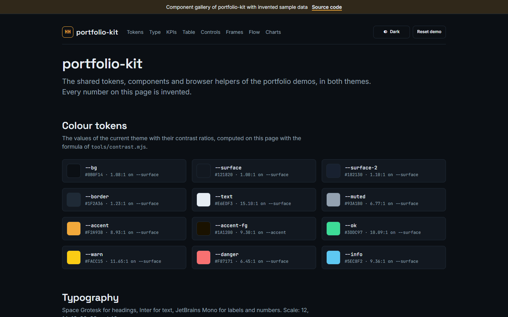
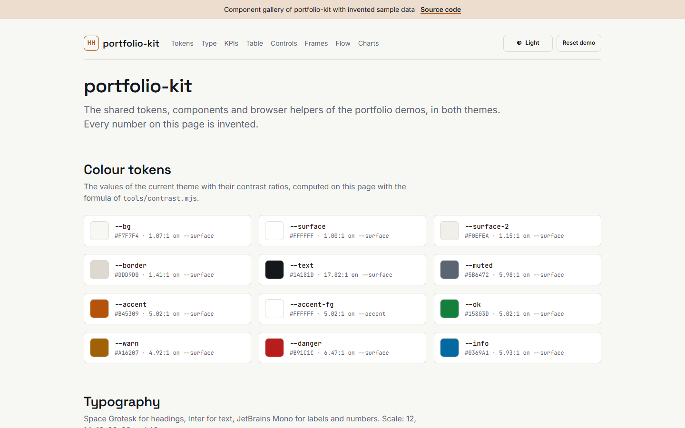
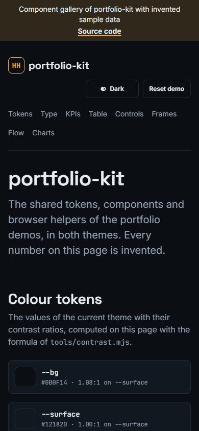
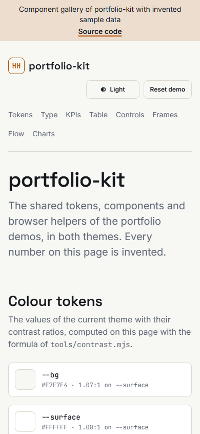

# portfolio-kit

[](https://github.com/HARISPAARTAN/portfolio-kit/actions/workflows/ci.yml) [](https://github.com/HARISPAARTAN/portfolio-kit/actions/workflows/pages.yml)

The shared look and the shared browser helpers of the freelance demo repositories by Harithas Harikaran: colour tokens for a dark and a light theme, base styles and components, a theme boot, a small store, a filter bus, formatters, CSV export, a flow player, an ECharts palette and three self-hosted fonts. There is no build step, no dependency and no request to another host: a consuming repository copies `dist/` at a tag into `web/kit/` and loads the files relatively.

Component gallery with invented sample data: https://harispaartan.github.io/portfolio-kit/demo/

| Dark | Light |
|---|---|
|  |  |
|  |  |

## Status

v0.1.0, not published yet. Checked locally before the first push:

- 95 unit tests pass on Node 22 plus 20 Python tests for the sync script without any package (`node --test "tests/*.test.mjs"`): contrast floors of both themes, the flow state machine, store, filter bus, formatters, CSV, sorting, chart palette and themes, the manifest and the offline scan.
- Size limits hold: `kit.js` 25,900 of 40,960 bytes, `base.css` 12,910 of 30,720, `tokens.css` 1,635 of 6,144, every font below 122,880.
- `dist/` and `demo/` contain no `http://`, `https://` or protocol-relative reference other than the repository link and the SVG namespace (the font licence file is exempt).
- `dist/MANIFEST.json` matches the 11 files of `dist/`; a vendoring round trip with `tools/sync_kit.py` copies them, confirms the copy and reports a changed file.
- The page check (`tools/checks/demo.mjs`, Playwright driving Chrome) passes 96 checks on `demo/`: dark and light at 1440 and 390 px (fonts loaded, banner, no horizontal scroll, in-page links, page weight 181 KB, all 51 controls reachable with Tab, sorting, paging, filtering with the saved state, reset, CSV download, keyboard tabs, the flow player in auto-play and programmatic mode, labels not cut short, device frames, theme toggle, no external request, HTTP error or console error), a run with reduced motion and the redirect of the root page.
- Both categorical chart palettes pass every check of the palette validator; the sequential and diverging ramps pass its ordinal checks.

Not tested: browsers other than Chrome, screen readers.

## Kurzfassung (Deutsch)

portfolio-kit bündelt das gemeinsame Erscheinungsbild und die Browser-Hilfen der Freelance-Demo-Repositorys: Farb-Tokens für ein dunkles und ein helles Theme, Basis-Styles und Komponenten, einen Theme-Boot, einen kleinen Speicher, einen Filter-Bus, Formatierer, CSV-Export, einen Flow-Player, eine ECharts-Palette und drei selbst gehostete Schriften. Es gibt keinen Build-Schritt, keine Abhängigkeit und keine Anfrage an fremde Hosts: Jedes nutzende Repository kopiert `dist/` zu einem festen Tag nach `web/kit/` und prüft die Kopie mit `tools/sync_kit.py --check` gegen die SHA-256-Werte in `dist/MANIFEST.json`. Die Komponenten-Galerie unter https://harispaartan.github.io/portfolio-kit/demo/ zeigt alles in beiden Themes; alle Daten dort sind erfunden. Lizenz: MIT für das Kit, SIL Open Font License 1.1 für die Schriften.

## Contents

| Path | What it is |
|---|---|
| `dist/tokens.css` | colour, font, radius, shadow, spacing and width tokens; dark on `:root`, light on `:root[data-theme="light"]` |
| `dist/base.css` | reset, type scale and the `pf-` components |
| `dist/theme-boot.js` | classic script for `<head>`: sets `data-theme` before the first paint, exposes `window.pfTheme` |
| `dist/kit.js` | ES module: store, filter bus, formatters, CSV, sorting, renderers, tabs, device frames, flow player |
| `dist/flow-state.js` | ES module: the flow state machine, no DOM |
| `dist/echarts-theme.js` | ES module: chart palette, ramps and ECharts themes (ECharts itself is not included) |
| `dist/fonts/` | `fonts.css`, Inter, Space Grotesk and JetBrains Mono as variable woff2 files, and their licence |
| `dist/MANIFEST.json` | name, version, and bytes and SHA-256 of every other file in `dist/` |
| `demo/index.html` | the component gallery, published on Pages |
| `tests/` | unit tests for `node --test` |
| `tools/` | `contrast.mjs`, `check_size.mjs`, `check_offline.mjs`, `manifest.mjs`, `sync_kit.py` (the reference vendoring script) and `checks/demo.mjs` (the page check) |

## Quick start

A page in `web/` of a consuming repository, with the kit vendored at `web/kit/`:

```html
<!doctype html>
<html lang="en">
<head>
<meta charset="utf-8">
<meta name="viewport" content="width=device-width, initial-scale=1, viewport-fit=cover">
<title>Orders</title>
<link rel="stylesheet" href="kit/fonts/fonts.css">
<link rel="stylesheet" href="kit/tokens.css">
<link rel="stylesheet" href="kit/base.css">
<script src="kit/theme-boot.js"></script>
</head>
<body>
<div class="pf-page">
  <header class="pf-header">
    <a class="pf-brand" href="./"><span class="pf-brand__mark" aria-hidden="true">HH</span>Orders</a>
    <div class="pf-header__tools"><span id="theme"></span></div>
  </header>
  <main>
    <div class="pf-grid" id="kpis"><div></div><div></div></div>
    <div id="orders"></div>
  </main>
  <footer class="pf-footer"><p>Rebuilt from memory as a demo. The original client's name and data are not used.</p></footer>
</div>
<script type="module">
import { fmt, mountBanner, mountThemeToggle, renderKpi, renderTable } from './kit/kit.js';

mountBanner({ repoUrl: 'https://github.com/HARISPAARTAN/data-cleaning-tool' });
mountThemeToggle(document.getElementById('theme'));
const rows = [{ id: 'SO-1001', revenue: 360 }, { id: 'SO-1002', revenue: 1290 }];
const [a, b] = document.getElementById('kpis').children;
renderKpi(a, { label: 'Revenue', value: fmt.money(1650) });
renderKpi(b, { label: 'Orders', value: fmt.int(rows.length) });
renderTable(document.getElementById('orders'), { columns: [{ key: 'id', label: 'Order' }, { key: 'revenue', label: 'Revenue', align: 'right', format: (v) => fmt.money(v) }], rows });
</script>
</body>
</html>
```

The order matters: the stylesheets and `theme-boot.js` sit in `<head>`, so the theme is set before the first paint; `kit.js` is a module and runs after parsing.

## Tokens

`dist/tokens.css` defines the tokens on `:root` (dark, the default) and again on `:root[data-theme="light"]`. Every rule in `base.css` reads only these. `color-scheme` is `dark` on `:root` and `light` under the light attribute.

| Token | Dark | Light | Use |
|---|---|---|---|
| `--bg` | `#0B0F14` | `#F7F7F4` | page background (`body` sets it) |
| `--surface` | `#121820` | `#FFFFFF` | cards, tiles, tables |
| `--surface-2` | `#182130` | `#F0EFEA` | nested surfaces, striped rows, default buttons |
| `--border` | `#1F2A36` | `#DDD9D0` | borders, rules |
| `--text` | `#E6EDF3` | `#14181D` | body text |
| `--muted` | `#93A1B0` | `#5B6472` | secondary text, captions, labels |
| `--accent` | `#F2A93B` | `#B45309` | emphasis, primary buttons, links, focus ring |
| `--accent-fg` | `#1A1200` | `#FFFFFF` | text on `--accent` |
| `--ok` | `#3DDC97` | `#15803D` | success, favourable |
| `--warn` | `#FACC15` | `#A16207` | thresholds, attention |
| `--danger` | `#F87171` | `#B91C1C` | errors, unfavourable |
| `--info` | `#5EC8F2` | `#0369A1` | neutral highlights |
| `--chart-1` | `#C38102` | `#B45309` | amber, first series |
| `--chart-2` | `#058DB5` | `#0369A1` | sky |
| `--chart-3` | `#02AB70` | `#15803D` | green |
| `--chart-4` | `#AB6FE5` | `#7E22CE` | violet |
| `--chart-5` | `#CA445C` | `#EB4960` | rose |
| `--chart-6` | `#77A304` | `#3B6201` | lime |
| `--chart-7` | `#028E7F` | `#00948A` | teal |
| `--chart-8` | `#7A84EF` | `#4338CA` | indigo |
| `--font-text` | `"Inter", system-ui, -apple-system, "Segoe UI", Roboto, sans-serif` | same | body text |
| `--font-display` | `"Space Grotesk", "Inter", system-ui, sans-serif` | same | headings |
| `--font-mono` | `"JetBrains Mono", "Cascadia Code", Consolas, "Liberation Mono", monospace` | same | labels, code, numbers |
| `--radius` / `--radius-sm` | `14px` / `8px` | same | cards / controls |
| `--shadow` | `0 1px 0 rgba(255,255,255,.03) inset, 0 12px 32px rgba(0,0,0,.35)` | `0 1px 2px rgba(20,24,29,.06), 0 10px 28px rgba(20,24,29,.08)` | cards, tiles, frames |
| `--space-1` … `--space-8` | `4px 8px 12px 16px 24px 32px 48px 64px` | same | spacing scale |
| `--max` | `1120px` | same | content width of `.pf-page` |
| `--gutter` | `max(16px, env(safe-area-inset-left))` | same | side padding |

Contrast (WCAG 2.x), checked by `tests/contrast.test.mjs` against `dist/tokens.css`; `node tools/contrast.mjs` prints every pair:

| Pair | Floor | Dark | Light |
|---|---|---|---|
| `--text` on `--bg`, `--surface`, `--surface-2` | 7 | 16.27, 15.10, 13.68 | 16.61, 17.82, 15.48 |
| `--muted` on `--bg`, `--surface`, `--surface-2` | 4.5 | 7.29, 6.77, 6.13 | 5.57, 5.98, 5.20 |
| `--accent-fg` on `--accent` | 4.5 | 9.30 | 5.02 |
| `--ok`, `--warn`, `--danger`, `--info` on `--surface` | 3 | 10.09, 11.65, 6.45, 9.36 | 5.02, 4.92, 6.47, 5.93 |
| `--chart-1` … `--chart-8` on `--surface` | 3 | 5.49, 4.66, 6.00, 5.21, 3.82, 5.97, 4.40, 5.41 | 5.02, 5.93, 5.02, 6.98, 3.71, 7.16, 3.75, 7.90 |
| pill text on its tint: ok, warn, danger, info, muted, accent | 4.5 | 7.47, 8.11, 6.04, 7.18, 6.25, 7.15 | 5.50, 5.44, 6.51, 6.13, 6.24, 5.56 |

The status and chart colours colour marks, borders and tints; text in them uses the pill mix below, never the plain token on a light surface.

## Base styles

`base.css` starts with a reset (box sizing, margins, `img` and `svg` as blocks with `max-width: 100%`, `[hidden]` always hidden, form controls inherit the font), sets `body` to `--bg`, `--text` and `--font-text` at 16 px with a line height of 1.5, sets headings in `--font-display` with `text-wrap: balance`, links in `--accent`, a focus ring of `2px solid var(--accent)` with a 2 px offset on every `:focus-visible` element, and turns every animation and transition off under `prefers-reduced-motion: reduce`.

| Variable | Value | Use |
|---|---|---|
| `--fs-xs` `--fs-sm` `--fs-md` `--fs-lg` `--fs-xl` `--fs-2xl` | 12, 14, 16, 20, 28, 40 px | type scale; `h1` 40, `h2` 28, `h3` 20, `h4` 16 |
| `--pf-banner-h` | `40px`, then the measured banner height | top padding under the fixed banner (set by `mountBanner`) |
| `--pf-control-border` | 65 % `--muted` mixed into `--border` | border of inputs, selects, chips and empty states: 3.90:1 (dark) and 3.34:1 (light) against `--surface` |
| `--min` | `220px` | minimum column width of `.pf-grid` |
| `--table-h` | `none` | maximum height of `.pf-table-wrap`; with a value the header stays in view while the rows scroll |
| `--scale` | `1` | scale of a `.pf-frame` (set by `fitFrame`) |

## Components

All classes start with `pf-`. Everything works at 390 px without horizontal page scrolling; only `.pf-table-wrap` and `.pf-frame__screen` scroll inside themselves.

### Page, header, brand and footer

`.pf-page` is the outer wrapper (`max-width: var(--max)`, side padding `--gutter`, block padding `--space-6`). `.pf-header` is a wrapping row: `.pf-brand` (a link with the `.pf-brand__mark` monogram in `--accent` and the page name), `.pf-header__nav` (muted links; `aria-current` marks the current one; below 720 px the nav moves to its own line) and `.pf-header__tools` (pushed to the right). `.pf-footer` is small muted text with a top rule.

```html
<div class="pf-page">
  <header class="pf-header">
    <a class="pf-brand" href="./"><span class="pf-brand__mark" aria-hidden="true">HH</span>Invoice inbox</a>
    <nav class="pf-header__nav" aria-label="Sections"><a href="#overview" aria-current="true">Overview</a><a href="#list">List</a></nav>
    <div class="pf-header__tools"><span id="theme"></span><button type="button" class="pf-btn pf-btn--ghost pf-btn--sm" id="reset">Reset demo</button></div>
  </header>
  <main id="overview">…</main>
  <footer class="pf-footer">
    <p>Rebuilt from memory as a demo. The original client's name and data are not used.</p>
    <p><a href="https://github.com/HARISPAARTAN/data-cleaning-tool">Source on GitHub</a></p>
  </footer>
</div>
```

### Banner

`.pf-banner` is the fixed demo notice at the top edge (`position: fixed; top: env(safe-area-inset-top)`), with the text and a link "Source code". `body.pf-has-banner` pads the page by `--pf-banner-h` and sets `scroll-padding-top`, so anchors land below the banner. `mountBanner()` creates both; the markup it inserts as the first child of `body` is:

```html
<aside class="pf-banner" aria-label="Demo notice"><span>Demo with invented data for a fictional company</span><a href="https://github.com/HARISPAARTAN/data-cleaning-tool">Source code</a></aside>
```

### Card, grid, row and stack

`.pf-card` is a surface with border, radius, shadow and `--space-5` padding; `.pf-card__title` is its heading. `.pf-grid` is `repeat(auto-fit, minmax(min(var(--min, 220px), 100%), 1fr))` with a `--space-4` gap. `.pf-row` is a wrapping flex row and `.pf-stack` a vertical stack, both with a `--space-3` gap.

```html
<div class="pf-grid" style="--min:280px">
  <section class="pf-card"><h3 class="pf-card__title">Open invoices</h3><div class="pf-stack"><p>12 waiting</p><p>3 overdue</p></div></section>
  <section class="pf-card"><h3 class="pf-card__title">Actions</h3><div class="pf-row"><button type="button" class="pf-btn">Approve</button><button type="button" class="pf-btn pf-btn--ghost">Skip</button></div></section>
</div>
```

### Label and visually hidden text

`.pf-label` is a 12 px upper-case label in `--font-mono` with `letter-spacing: .06em` in `--muted`. `.pf-visually-hidden` hides text visually and keeps it for screen readers.

```html
<p class="pf-label">Last 30 days</p>
<button type="button" class="pf-btn pf-btn--sm">✕<span class="pf-visually-hidden">Remove filter</span></button>
```

### KPI tile

`.pf-kpi` holds `.pf-kpi__label` (with `.pf-label`), `.pf-kpi__value` (28 px mono, tabular numbers), `.pf-kpi__delta` with `--up` (`--ok`), `--down` (`--danger`) or `--neutral` (`--muted`) plus a ▲, ▼ or ● marker so colour is never the only signal, and `.pf-kpi__caption`. `renderKpi()` writes this markup:

```html
<div class="pf-kpi">
  <div class="pf-kpi__label pf-label">Revenue</div>
  <div class="pf-kpi__value">€54,454</div>
  <div class="pf-kpi__delta pf-kpi__delta--up"><span aria-hidden="true">▲ </span>+22.0 % Oct vs Sep</div>
  <div class="pf-kpi__caption">September and October 2025</div>
</div>
```

### Table and pager

`.pf-table-wrap` scrolls in both directions and holds a `.pf-table`: header cells in the label style and sticky, `.pf-num` cells right-aligned in mono with tabular numbers, striped rows in `--surface-2`. In sortable headers `.pf-table__sort` is the button; `th[aria-sort="ascending"]` and `"descending"` show ▲ and ▼ in `--accent`, unsorted columns show ↕. `.pf-table__empty` is the cell of an empty table. `.pf-pager` holds `.pf-pager__info` ("1–8 of 40") and the Previous and Next buttons. `renderTable()` builds all of it; a static table uses the same classes:

```html
<div class="pf-table-wrap" tabindex="0" role="region" aria-label="Invoices" style="--table-h:360px">
  <table class="pf-table">
    <thead><tr><th scope="col">Invoice</th><th scope="col" class="pf-num">Amount</th></tr></thead>
    <tbody><tr><td>INV-2042</td><td class="pf-num">€1,280</td></tr><tr><td>INV-2043</td><td class="pf-num">€96</td></tr></tbody>
  </table>
</div>
```

### Pill

`.pf-pill` with `--ok`, `--warn`, `--danger`, `--info`, `--muted` or `--accent`: 12 px mono on a tint of the colour (18 % over `--surface`), with a border at 40 % and text mixed from 75 % of the colour and 25 % of `--text`, which keeps every pill at 4.5:1 or more (see the contrast table). The modifiers set the custom property `--pill`.

```html
<span class="pf-pill pf-pill--ok">Delivered</span> <span class="pf-pill pf-pill--warn">Open</span> <span class="pf-pill pf-pill--danger">Cancelled</span>
```

### Buttons and the theme toggle

`.pf-btn` styles buttons and link buttons (44 px minimum height): the default on `--surface-2`, `--primary` on `--accent` with `--accent-fg` text, `--ghost` with a border only, `--sm` at 36 px. `:disabled` and `[aria-disabled="true"]` look disabled; the second form stays focusable. `.pf-theme-toggle` is the class of the button `mountThemeToggle()` renders (a minimum width, so the header does not move when the label changes).

```html
<button type="button" class="pf-btn pf-btn--primary">Save</button>
<button type="button" class="pf-btn">Default</button>
<button type="button" class="pf-btn pf-btn--ghost pf-btn--sm">Small</button>
<a class="pf-btn pf-btn--ghost" href="#list">Link button</a>
<button type="button" class="pf-btn" disabled>Disabled</button>
```

### Tabs

`.pf-tabs` is a `role="tablist"`, `.pf-tab` a `role="tab"` (the selected one is underlined in `--accent`), `.pf-tabpanel` a `role="tabpanel"`. `initTabs()` adds the keyboard behaviour.

```html
<div class="pf-tabs" role="tablist" aria-label="Invoice views" id="views">
  <button type="button" class="pf-tab" role="tab" id="tab-open" aria-controls="panel-open" aria-selected="true">Open</button>
  <button type="button" class="pf-tab" role="tab" id="tab-done" aria-controls="panel-done" aria-selected="false" tabindex="-1">Done</button>
</div>
<div class="pf-tabpanel" role="tabpanel" id="panel-open" aria-labelledby="tab-open" tabindex="0">Open invoices</div>
<div class="pf-tabpanel" role="tabpanel" id="panel-done" aria-labelledby="tab-done" tabindex="0" hidden>Booked invoices</div>
```

### Chips

`.pf-chips` holds toggle chips for multi-select filters; `.pf-chip[aria-pressed="true"]` (or `.pf-chip--active`) shows the accent border, a tint and a ✓.

```html
<div class="pf-chips" role="group" aria-label="Region">
  <button type="button" class="pf-chip" aria-pressed="true">North</button>
  <button type="button" class="pf-chip" aria-pressed="false">South</button>
</div>
```

### Select and input

`.pf-select` and `.pf-input` are 44 px high with the `--pf-control-border` border; the placeholder uses `--muted`.

```html
<label for="q">Search</label> <input class="pf-input" id="q" type="search" placeholder="Invoice number">
<label for="period">Period</label> <select class="pf-select" id="period"><option>September 2025</option><option>October 2025</option></select>
```

### Device frames

`.pf-frame` with `.pf-frame--phone` (inner viewport 390 × 844) or `.pf-frame--tablet` (1024 × 720) draws a rounded bezel; `.pf-frame__screen` is the viewport and scrolls inside. `fitFrame()` sets `--scale` so the frame fits its parent's content width.

```html
<div class="pf-frame pf-frame--phone" id="phone">
  <div class="pf-frame__screen" tabindex="0" role="region" aria-label="Phone screen">…</div>
</div>
```

### Flow player

`FlowPlayer` renders into an element with the class `.pf-flow`: `.pf-flow__diagram` (an inline SVG with `g.pf-flow__node[data-id][data-status]`, its `.pf-flow__glyph` and `.pf-flow__name`, `path.pf-flow__edge` with `data-done` once traversed, the arrowhead `.pf-flow__arrow` and the moving `circle.pf-flow__dot`), `.pf-flow__controls`, the step list `ol.pf-flow__steps` with `li.pf-flow__step` (`data-status`, `aria-current="step"` on the current step), `.pf-flow__idx` and `.pf-flow__detail`, and a polite live region. Status colours: running `--accent`, ok `--ok`, failed `--danger`, skipped `--muted` with a dashed outline.

### Empty state

```html
<div class="pf-empty"><strong>No invoices yet</strong><span>New invoices appear here once they arrive.</span></div>
```

## `theme-boot.js`

A classic script without dependencies for `<head>`. It reads `localStorage['hh-theme']` (in a try/catch): `light` or `dark` wins; otherwise it follows `prefers-color-scheme`, with dark as the default. It always sets `data-theme` on `<html>`. `hh-theme` is the portfolio site's own key, so one choice spans the site and every demo.

```html
<script src="kit/theme-boot.js"></script>
```

```js
window.pfTheme.get();          // 'dark' or 'light'
window.pfTheme.set('light');   // sets data-theme, stores hh-theme, dispatches pf:theme
window.pfTheme.toggle();
document.addEventListener('pf:theme', (e) => console.log(e.detail.theme));
```

When `hh-theme` changes in another tab the page follows it, and while nothing is stored it follows changes of the system preference; both dispatch `pf:theme`.

## `kit.js`

```js
import { FlowPlayer, createFilterBus, createFlowState, createStore, download, fitFrame, fmt, initTabs, mountBanner, mountThemeToggle, pill, renderKpi, renderTable, sortRows, toCsv } from './kit/kit.js';
```

Renderers create elements with the DOM API (never `innerHTML` with data) and are idempotent: calling one again on the same element replaces what it rendered before.

### `createStore(ns, { version = 1, storage } = {})`

Returns `{ key, available, load(), save(obj), clear() }`. The key is `pf.<ns>.v<version>`; values are JSON in `localStorage`, every access is wrapped in try/catch. When storage is blocked or throws, `available` is `false` and the value lives in memory for the page view; `save` returns `true` only when the value reached storage. A new `version` starts empty and leaves the old key alone. `storage` replaces `localStorage` (used by the tests).

```js
const store = createStore('orders-demo');   // key 'pf.orders-demo.v1'
store.save({ region: ['North'] });          // true when stored
store.load();                               // { region: ['North'] }, or null when empty or unreadable
store.clear();
```

### `createFilterBus()`

Returns `{ state(), get(dim), set(dim, value), toggle(dim, value), clear(dim?), subscribe(fn) }`. The state is a frozen object; `set(dim, null)` removes a dimension; `toggle` sets the value or removes it when it is already the value (click to cross-filter, click again to clear); arrays and objects compare by value; `get` returns `null` for a missing dimension. Subscribers run synchronously after every change with `(state, { dim, value })`; calls that change nothing notify nobody; `subscribe` returns the unsubscribe function.

```js
const bus = createFilterBus();
const off = bus.subscribe((state, change) => console.log(state, change));
bus.set('region', 'North');      // { region: 'North' }  { dim: 'region', value: 'North' }
bus.toggle('region', 'North');   // {}                   { dim: 'region', value: null }
bus.toggle('status', 'Open');    // { status: 'Open' }   { dim: 'status', value: 'Open' }
bus.set('status', 'Open');       // no change, no call
bus.clear();                     // {}                   { dim: null, value: null }
off();
```

### `fmt`

Formatters in the `en-GB` locale built on `Intl.NumberFormat`. Negative numbers use the minus sign U+2212, never a hyphen; `%` and `pp` follow a no-break space (U+00A0, shown as a space below); `null`, `undefined`, `NaN`, infinities, empty strings, booleans and dates that cannot be read render as an en dash `–`. Numeric strings are read as numbers.

| Call | Result |
|---|---|
| `fmt.int(1234567.4)` | `1,234,567` |
| `fmt.int(-1234)` | `−1,234` |
| `fmt.dec(3.14159, 2)` / `fmt.dec(2)` | `3.14` / `2.0` |
| `fmt.money(1234.5)` | `€1,235` |
| `fmt.money(-99.5, 'EUR', 2)` | `−€99.50` |
| `fmt.money(1200, 'GBP')` | `£1,200` |
| `fmt.compact(950)` / `fmt.compact(1234)` / `fmt.compact(3400000)` | `950` / `1.2k` / `3.4m` |
| `fmt.pct(0.123)` / `fmt.pct(0.5, 0)` | `12.3 %` / `50 %` |
| `fmt.pp(0.012)` / `fmt.pp(-0.05)` / `fmt.pp(0)` | `+1.2 pp` / `−5.0 pp` / `0.0 pp` (the argument is a difference of two shares) |
| `fmt.signed(3)` / `fmt.signed(-2)` / `fmt.signed(0)` / `fmt.signed(1.25, 1)` | `+3` / `−2` / `0` / `+1.3` |
| `fmt.date('2025-10-01')` | `01 Oct 2025` |
| `fmt.dateTime('2025-10-01T09:00:00+02:00')` | `01 Oct 2025 09:00` |
| `fmt.int(null)` / `fmt.date('2025-02-30')` | `–` / `–` |

`date` and `dateTime` show the wall-clock value written in the ISO string, without converting time zones; `Date` objects are read in UTC.

### `toCsv(rows, columns, { delimiter = ',', bom = true, escapeFormulas = true } = {})`

Returns CSV text: a UTF-8 BOM by default, a header row from `columns` (`[{ key, label }]`, the label defaults to the key) in their order, CRLF after every line including the last, RFC 4180 quoting of cells with the delimiter, quotes or line breaks, and a leading `'` on text cells starting with `=`, `+`, `-`, `@`, a tab or a carriage return (numbers keep their sign). Dates become ISO strings, `null` and missing keys empty cells.

```js
const csv = toCsv([{ id: 'SO-1', note: 'Paid, thanks', total: -5, formula: '=SUM(A1)' }], [{ key: 'id', label: 'Order' }, { key: 'note', label: 'Note' }, { key: 'total', label: 'Total' }, { key: 'formula', label: 'Formula' }]);
// BOM + 'Order,Note,Total,Formula\r\nSO-1,"Paid, thanks",-5,\'=SUM(A1)\r\n'
download('orders.csv', csv);
```

### `sortRows(rows, key, dir = 'asc')`

Returns a new array sorted by `row[key]`: numbers numerically, text with `Intl.Collator('en-GB', { numeric: true, sensitivity: 'base' })`, dates by time, `false` before `true`. Blank values (`null`, `undefined`, `''`, `NaN`) go last in both directions; ties keep their order. `renderTable` sorts with it.

```js
sortRows([{ n: 3 }, { n: null }, { n: 1 }, { n: 2 }], 'n', 'desc');   // 3, 2, 1, null
sortRows([{ s: 'item 10' }, { s: 'Item 2' }, { s: 'item 1' }], 's'); // item 1, Item 2, item 10
```

### `mountBanner({ repoUrl, text = 'Demo with invented data for a fictional company' })`

Inserts the `.pf-banner` (see Components) as the first child of `body`, adds `pf-has-banner` to `body`, keeps `--pf-banner-h` on `<html>` equal to the banner height and returns the banner element. Calling it again replaces the banner.

```js
mountBanner({ repoUrl: 'https://github.com/HARISPAARTAN/data-cleaning-tool' });
```

### `mountThemeToggle(el)`

Renders a `.pf-theme-toggle` button into `el` and returns it. The label names the current theme ("Dark" or "Light"), `aria-pressed` is `true` in light, a click calls `window.pfTheme.toggle()`, and the label follows every `pf:theme` event. Without `theme-boot.js` the button is disabled.

```js
mountThemeToggle(document.getElementById('theme'));
```

### `renderKpi(el, { label, value, delta?, caption? })`

Renders one `.pf-kpi` into `el` and returns `{ update(data) }`. `delta` is `{ text, kind: 'up' | 'down' | 'neutral' }`; a missing `value` shows `–`.

```js
const tile = renderKpi(document.getElementById('revenue'), { label: 'Revenue', value: fmt.money(54454), delta: { text: `+${fmt.pct(0.22)} Oct vs Sep`, kind: 'up' }, caption: 'September and October 2025' });
tile.update({ label: 'Revenue', value: fmt.money(48100) });
```

### `pill(text, kind = 'muted')`

Returns a `span.pf-pill.pf-pill--<kind>`; an unknown kind falls back to `muted`. Useful as a table cell format.

```js
document.getElementById('status').append(pill('Delivered', 'ok'));
```

### `renderTable(el, { columns, rows = [], pageSize = 0, caption = '', emptyText = 'No rows to show' })`

Renders `.pf-table-wrap > table.pf-table` into `el`, plus a `.pf-pager` when `pageSize` is above 0, and returns `{ update(rows), sort(key, dir = 'asc'), rows() }`. Each column is `{ key, label?, align?: 'left' | 'right', format?: (value, row) => string | Node, sortable? = true }`; `align: 'right'` adds `.pf-num`; a `format` that returns a node (for example a `pill`) is inserted as it is; header cells carry `data-key`. A click on a header sorts ascending, a second click descending (stable, blanks last); only the sorted column has `aria-sort`. `update` keeps the sort and returns to the first page; `rows()` returns all rows in the current order. The pager buttons use `aria-disabled` at the ends, so they stay in the tab order.

```js
const table = renderTable(document.getElementById('orders'), {
  columns: [
    { key: 'id', label: 'Order' },
    { key: 'date', label: 'Date', format: (v) => fmt.date(v) },
    { key: 'revenue', label: 'Revenue', align: 'right', format: (v) => fmt.money(v, 'EUR', 2) },
    { key: 'status', label: 'Status', format: (v) => pill(v, v === 'Delivered' ? 'ok' : 'muted') },
  ],
  rows: orders,
  pageSize: 8,
  caption: 'Orders, September and October 2025',
});
table.sort('revenue', 'desc');
table.update(orders.filter((o) => o.region === 'North'));
```

### `download(filename, text, mime = 'text/csv;charset=utf-8')`

Starts a download of `text` through an object URL, which is revoked a second later.

```js
download('orders.csv', toCsv(table.rows(), [{ key: 'id', label: 'Order' }, { key: 'revenue', label: 'Revenue' }]));
```

### `fitFrame(frameEl)`

Sets `--scale` on a `.pf-frame` so that it fits the content width of its parent, follows resizes with a `ResizeObserver`, never scales above 1, and returns a function that stops it. Calling it again on the same frame replaces the previous observer.

```js
const stop = fitFrame(document.getElementById('phone'));
```

### `initTabs(tablistEl, { onChange } = {})`

Wires an ARIA tablist: click, ArrowLeft, ArrowRight (both wrap), Home and End move the selection and the focus; one tab has `tabindex="0"`, the others `-1`; the panel named in `aria-controls` is shown and the others hidden. `onChange(tabId, tabEl)` runs after a change. Returns `{ select(idOrIndexOrElement) }`.

```js
const tabs = initTabs(document.getElementById('views'), { onChange: (id) => console.log(id) });
tabs.select('tab-done');
```

### `FlowPlayer`

`new FlowPlayer(el, { state, orientation = 'auto', stepMs = 900, autoplay = false, controls = true })` draws the steps of a `createFlowState` state as boxes and arrows (a row when `el` is at least 720 px wide, a column otherwise; `orientation: 'row'` or `'column'` forces one), a step list with the details, and, with `controls`, the buttons Play (Pause while playing, Replay at the end) and "Skip animation". Steps with edges between them are laid out in layers, so a branch shows side by side. While playing it calls `state.next()` every `stepMs` and moves a dot along the arrow. Labels that do not fit are shortened with `…`, measured after the fonts have loaded. The live region announces "Step 3 of 9: Classify", with " (done)", " (failed)" or " (skipped)" for finished steps, and "Ready: 9 steps" after a reset. Under reduced motion no dot moves, autoplay does not start and Play applies every step at once. Methods: `play()`, `pause()`, `skipToEnd()`, `destroy()`. A new player on the same element destroys the old one.

```js
const state = createFlowState({ steps: [{ id: 'intake', label: 'Intake', detail: 'Read 40 rows' }, { id: 'validate', label: 'Validate' }, { id: 'export', label: 'Export' }] });
new FlowPlayer(document.getElementById('flow'), { state, autoplay: true });
```

Programmatic mode: the caller drives the state and never calls `play()`.

```js
const inbox = createFlowState({
  steps: [{ id: 'receive', label: 'Receive' }, { id: 'check', label: 'Check' }, { id: 'approve', label: 'Approve' }, { id: 'reject', label: 'Reject' }],
  edges: [['receive', 'check'], ['check', 'approve'], ['check', 'reject']],
});
new FlowPlayer(document.getElementById('inbox-flow'), { state: inbox, controls: false });
inbox.show('receive', { detail: 'Invoice INV-2042 received' });
inbox.show('check');
inbox.skip('reject');
inbox.fail('approve', 'Amount above the limit');
```

`createFlowState` is re-exported from `flow-state.js`, so one import line is enough.

## `flow-state.js`

The state machine behind the player, with no DOM, so it is tested in Node.

`createFlowState({ steps: [{ id, label?, detail? }], edges?: [[fromId, toId]] })` returns:

| Member | Behaviour |
|---|---|
| `steps()` | copies of the steps with their current details |
| `edges()` | copies of the edges; without `edges` the steps form a chain in their order |
| `current()` | `{ id, index, label, detail, status }` of the current step, or `null` |
| `statuses()` | `{ [id]: 'idle' | 'running' | 'ok' | 'failed' | 'skipped' }` |
| `done()` | `true` when every step is ok, failed or skipped |
| `start()` | resets and marks the first step running |
| `next()` | marks the running step ok and the next idle step running (after the current one first, then from the start); `false` when no idle step is left |
| `show(idOrIndex, { status = 'ok', detail } = {})` | sets one step's status and detail and makes it current |
| `fail(idOrIndex, detail?)` | marks a step failed and makes it current |
| `skip(idOrIndex)` | marks a step skipped; the current step stays |
| `reset()` | every step idle again, the original details back |
| `subscribe(fn)` | `fn(state, { type, id })` after every change; returns the unsubscribe function |

`STATUSES` is the frozen list `['idle', 'running', 'ok', 'failed', 'skipped']`. Steps need unique non-empty string ids; an edge that names an unknown step, an unknown status or an unknown step reference throws.

```js
import { createFlowState, STATUSES } from './kit/flow-state.js';
const s = createFlowState({ steps: [{ id: 'a' }, { id: 'b' }] });
s.start();      // a running
s.next();       // a ok, b running
s.next();       // b ok; returns false
s.done();       // true
```

## `echarts-theme.js` and the chart palette

The module does not include ECharts; repositories that draw charts vendor ECharts themselves and pass it in.

```js
import { diverging, palette, registerThemes, sequential, statusColors, theme } from './kit/echarts-theme.js';
registerThemes(echarts);   // registers 'pf-dark' and 'pf-light'
const el = document.getElementById('revenue-chart');
const option = { xAxis: { type: 'category', data: ['Sep', 'Oct'] }, yAxis: { type: 'value' }, series: [{ type: 'bar', data: [24525, 29929] }] };
let chart;
const draw = () => {
  chart?.dispose();
  chart = echarts.init(el, `pf-${window.pfTheme.get()}`);
  chart.setOption(option);
};
draw();
document.addEventListener('pf:theme', draw);
```

| Export | Content |
|---|---|
| `palette.dark`, `palette.light` | the eight categorical colours, equal to `--chart-1` … `--chart-8` |
| `sequential.dark`, `sequential.light` | six amber steps from the lowest to the highest value (on dark the lowest is darkest, on light it is lightest) |
| `diverging.dark`, `diverging.light` | seven steps from most negative (rose) through a neutral grey to most positive (teal) |
| `statusColors(mode)` | `{ ok, warn, danger, info }`, equal to the tokens |
| `theme(mode)` | a new ECharts theme object: transparent background, text in `--text`, axis lines and ticks in `--border`, axis labels in `--muted`, split lines at 50 % `--border`, tooltip on `--surface` with a `--border` border, `color` from `palette`, `visualMap` from `sequential` |
| `registerThemes(echarts)` | registers `pf-dark` and `pf-light` and returns `{ dark: 'pf-dark', light: 'pf-light' }` |

Every exported colour list is frozen; `mode` must be `'dark'` or `'light'`.

| Ramp | Dark | Light |
|---|---|---|
| sequential | `#6D4200 #8B5502 #AB6901 #CB7E04 #EC940D #FFB257` | `#F29B1D #D78602 #BB7400 #9F6202 #845001 #694002` |
| diverging | `#FFA9AF #EE6476 #BC364E #3D3D3D #048073 #0EB09E #57DDCA` | `#9D1135 #D14A5F #FF7C8A #DEDEDE #36C3B0 #039585 #026359` |

The palette was checked with an OKLCH palette validator against the page backgrounds `#0B0F14` and `#F7F7F4`, and changed where a check failed. Final results:

| Check | Floor | Dark | Light |
|---|---|---|---|
| Lightness band (OKLCH L) | 0.48 to 0.67 dark, 0.43 to 0.77 light | all 8 inside | all 8 inside |
| Chroma floor | C ≥ 0.10 | all 8 | all 8 |
| Colour-vision separation of neighbours | ΔE ≥ 8 | worst 10.4 (`#77A304` and `#CA445C`, deuteranopia) | worst 10.6 (`#3B6201` and `#EB4960`, protanopia) |
| Normal-vision separation of neighbours | ΔE ≥ 15 | worst 15.7 (`#02AB70` and `#058DB5`) | worst 18.4 (`#00948A` and `#3B6201`) |
| Contrast against the page background | 3:1 | all 8 | all 8 |

The ramps pass the validator's ordinal checks (one hue per ramp or arm, monotone lightness, a gap of at least 0.06 in L between steps, the step nearest the background at 2:1 or more): sequential light 2.06, sequential dark 2.22, rose arm light 2.30, teal arm light 2.04, rose arm dark 3.46, teal arm dark 3.97. Compared with the first draft, all eight dark colours moved down into the lightness band, and in light rose and lime moved apart in lightness and teal gained chroma. The dark chart colours are therefore darker than the status tokens of the same hue: tokens colour text-sized marks on surfaces, chart colours colour areas and lines.

Order the series so that the most important one takes `--chart-1`, and label lines directly where they end, so no reader depends on colour alone.

## Vendoring into a demo repository

Consumers copy `dist/` at a tag into `web/kit/` and never edit the copy. The reference script is `tools/sync_kit.py` (Python 3.10 or newer, standard library only); copy it into the consuming repository's `tools/` folder.

1. Keep a clone of this repository next to the consumer (the script's default is `E:/GITGUB/portfolio-kit`; set `PORTFOLIO_KIT` or pass `--kit` for another path) and fetch the tags: `git -C E:/GITGUB/portfolio-kit fetch --tags`.
2. From the consumer's root, copy the kit at a tag:

   ```bash
   python tools/sync_kit.py --tag v0.1.0
   ```

   The script reads `dist/` at the tag with `git archive` (committed content only, nothing from the network), checks every file against the archived `MANIFEST.json`, replaces `web/kit/` (it refuses a folder that has files but no `MANIFEST.json`) and writes `web/kit/VERSION` with the tag. Output: `copied 11 files of portfolio-kit v0.1.0 into web/kit`.
3. Keep the bytes exactly as copied, whatever `core.autocrlf` says, with this line in the consumer's `.gitattributes`:

   ```text
   web/kit/** -text
   ```

4. Commit `web/kit/`, `tools/sync_kit.py` and `.gitattributes`.
5. Check the copy at any time: `python tools/sync_kit.py --check` compares `web/kit/` with `dist/` at the tag in `web/kit/VERSION` and prints `web/kit matches portfolio-kit v0.1.0` (exit 0), or one line per difference (`changed: kit.js`, `missing: …`, `not in MANIFEST.json: …`, a `VERSION` mismatch) and exit 1. Exit 2 means a usage or git error.
6. In the consumer's CI, after its own checkout, check out this repository at the pinned tag and run the same comparison (add `.kit/` to the consumer's `.gitignore`):

   ```yaml
         - name: Read the pinned kit version
           id: kit
           run: echo "tag=$(cat web/kit/VERSION)" >> "$GITHUB_OUTPUT"
         - uses: actions/checkout@v4
           with:
             repository: HARISPAARTAN/portfolio-kit
             ref: ${{ steps.kit.outputs.tag }}
             path: .kit
         - name: Vendored kit matches its tag
           run: python3 tools/sync_kit.py --check --kit .kit
   ```

7. To upgrade, read the CHANGELOG, run `python tools/sync_kit.py --tag <new tag>`, check the pages, and commit. A fix needed in a consumer goes into this repository first, gets a new tag, and is then synced.

The pages load the files relatively, as in the quick start: `kit/fonts/fonts.css`, `kit/tokens.css`, `kit/base.css`, `kit/theme-boot.js` in `<head>`, then `import { … } from './kit/kit.js'`. `fonts.css` finds the woff2 files next to itself, so the folder works wherever it sits.

## Development

Node 22 runs everything; there is no `package.json`.

```bash
node --test "tests/*.test.mjs"    # unit tests
node tools/contrast.mjs           # contrast of every token pair, exit 1 below a floor
node tools/check_size.mjs         # kit.js ≤ 40 KB, base.css ≤ 30 KB, tokens.css ≤ 6 KB, each font ≤ 120 KB
node tools/check_offline.mjs      # no reference to another host in dist/ or demo/
node tools/manifest.mjs           # rewrite dist/MANIFEST.json after any change in dist/
node tools/manifest.mjs --check   # exit 1 when dist/ and the manifest differ
```

The page check needs Playwright and Chrome. It loads Playwright with `createRequire` from the `package.json` named in `PLAYWRIGHT_FROM` (any folder whose `node_modules` contains `playwright`), serves the repository under `/portfolio-kit/` as Pages does, and writes the screenshots to `OUT` (default: a `portfolio-kit-shots` folder in the system temp directory). `BASE=https://harispaartan.github.io/portfolio-kit/` checks the published copy instead.

```bash
PLAYWRIGHT_FROM="$HOME/playwright-host/package.json" OUT="$HOME/kit-shots" node tools/checks/demo.mjs
```

CI (`.github/workflows/ci.yml`) runs the unit tests, the size, offline and manifest checks and a vendoring round trip with `tools/sync_kit.py` on pushes to `main`, on version tags and on pull requests; `pages.yml` runs the tests and the offline and manifest checks again and publishes the repository root to Pages on every push to `main`.

A release: update `CHANGELOG.md` and `VERSION`, run `node tools/manifest.mjs`, commit `chore: release X.Y.Z`, create an annotated tag `vX.Y.Z` and push it; consumers then sync to the new tag.

## Licence

MIT for the kit (see [LICENSE](LICENSE)); Inter, Space Grotesk and JetBrains Mono are redistributed unchanged under the SIL Open Font License 1.1 (see [LICENSES.md](LICENSES.md) and [dist/fonts/LICENSES.md](dist/fonts/LICENSES.md)). Changes are listed in [CHANGELOG.md](CHANGELOG.md).
